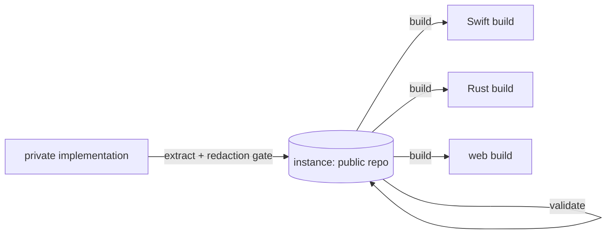

# unbuilt

Publish software as a specification instead of as code. Anyone can hand the spec to a coding agent and get a fresh build in their own language and environment.

[](https://github.com/vtrifonov/unbuilt/actions/workflows/ci.yml)
[](FORMAT.md)
[](package.json)
[](package.json)
[](LICENSE)

## What an unbuilt repo is

An unbuilt repo is a public repository that holds the specification of a finished private implementation and nothing else: the behaviour, the constraints, the scenarios that prove the behaviour, and the order to build it in. It holds no source code. Make one when you want to share an idea, with credit, without sharing the code, or when you want the idea to outlive the stack it was first written in.

Coding agents can now rebuild working software from a precise description. unbuilt is that description: small enough to read in an afternoon, strict enough to build from, and checked by a validator so the author cannot leak what they meant to keep.

This repository holds the contract ([FORMAT.md](FORMAT.md)), the validator, a template, a worked example and the agent skills.

```
my-tool-unbuilt/
  unbuilt.yaml          name, origin, license, platforms, modules
  README.md             what it is, who it is for, the author's terms
  SPEC.md               goal, glossary, invariants, exclusions
  constraints.md        platform, security and privacy MUSTs
  BUILD.md              ordered milestones, each with a "done when"
  modules/<capability>/
    problem.md          the pain it removes
    SPEC.md             requirements with stable IDs
    scenarios.md        Given/When/Then, citing requirement IDs
  substitutions/        choices left to the builder
  design/README.md      one entry per screen, with states
  evidence/             dated platform findings, with expiry
  known-failures.md     what the author tried that failed
```

## The three verbs

| Verb | Reads | Writes | What it does |
|---|---|---|---|
| **extract** | a source directory | an instance | Writes the spec, constraints, scenarios and build order. Marks requirements inferred from the code `(inferred)`. Runs a redaction pass with a gate where you opt in, per name, to anything that stays. |
| **build** | an instance | a project directory | Builds one milestone at a time following `BUILD.md`, in the language and environment you choose. Records where it departs from the spec and why. |
| **validate** | an instance | findings on stdout | Checks the instance against `FORMAT.md`: required files, YAML, requirement IDs, modality, scenario coverage, budgets and mechanical redaction. Never writes, never uses the network. |

Extract and build are agent skills. Validate is also a plain script, so it runs in CI.



One instance, many builds. The code never leaves, and every builder picks their own stack.

## Install

Claude Code:

```sh
claude plugin marketplace add vtrifonov/unbuilt
claude plugin install unbuilt@unbuilt
```

The skills are then `/unbuilt:extract`, `/unbuilt:build` and `/unbuilt:validate`.

Other agents: paste [`prompts/extract.md`](prompts/extract.md), [`prompts/build.md`](prompts/build.md) or [`prompts/validate.md`](prompts/validate.md) into the agent and replace the placeholders in angle brackets with real paths. The prompts are generated from the skills and say the same things.

## Quick start

Requires Node 22 or later. There is nothing to install: the validator has no dependencies.

```sh
git clone https://github.com/vtrifonov/unbuilt
cd unbuilt
node scripts/validate.mjs examples/clipjar
```

```
ok: clipjar passes unbuilt format 1
```

- **Build the example:** run `/unbuilt:build` on `examples/clipjar` with an empty project directory.
- **Extract your own:** run `/unbuilt:extract` on your project, answer the redaction gate, then run `node scripts/validate.mjs <output-dir>` until it prints `ok`.
- **Start from scratch:** copy `template/`. It already passes the validator.

## The example

[`examples/clipjar/`](examples/clipjar/) is extracted from a small macOS clipboard history app whose original is public at https://github.com/vtrifonov/clipjar, so a reader can compare the spec to the code and see what extraction kept and left out.

Requirements are one line each, with an ID, a modality and a mark when the author inferred it rather than decided it:

```markdown
- **CAPTURE-3** (MUST) (inferred) A copy the source app marks as concealed, transient
  or auto-generated, or that carries a known password-manager marker, is skipped,
  decided from type metadata before any content is read.
```

Scenarios cite what they prove:

```markdown
## Secrets are not captured

Covers: CAPTURE-3
Given a password manager copies a password marked concealed
When the tool checks the clipboard
Then no clip is created and the content is never read.
```

Milestones give an order and a check at each step:

```markdown
## Milestone 2: Persistent store

Covers: HISTORY-1, HISTORY-5, HISTORY-6, HISTORY-7, HISTORY-8, INV-3
Done when: clips survive a restart, a deleted clip's text is absent from the
database files, and a deliberately damaged database is set aside and replaced.
Effort: M
```

## The validator

```
usage: node scripts/validate.mjs <instance-dir> [--json] [--today YYYY-MM-DD]
```

Exit codes: 0 passes, 1 has errors, 2 could not read the directory. Warnings do not fail the run. A failing run looks like this:

```
error    leak-email         modules/paste/problem.md:9  email address op… found; replace it with a role word (FORMAT.md §7)
warning  should-has-scenario  modules/capture/SPEC.md:10  CAPTURE-8 is a SHOULD but no scenario cites it (FORMAT.md §5)
1 error(s), 1 warning(s)
```

Every finding names its rule, location and defining `FORMAT.md` section. Leaked values are masked, so the report is safe to paste. `--json` prints `errors` and `warnings` arrays.

The 28 rules cover structure, requirement IDs, modality, budgets and leaks: emails, IP addresses, hostnames, home paths, secret shapes and unscannable files. Leak rules scan text, file and directory names, image metadata and images embedded as `data:` URIs.

## Redaction: what is promised and what is not

The validator catches **mechanical** leaks: anything with a recognisable shape. It does not know that "the Berlin office" is private, and it cannot tell a person's name from a role word. That part is the extract skill's human pass and its redaction gate, where company and product names are removed by default and you opt in per name to each one that stays.

A passing instance has every required file, every MUST covered by a scenario, no leak of a known shape, and fits the budgets. That does not make it safe to publish. Read it once as a stranger would before you push.

## Prior art and positioning

Spec-driven tools (GitHub Spec Kit, Kiro, OpenSpec, BMAD, Tessl) turn a spec into code inside one project. ADRs record decisions. RFC 2119 gives MUST, SHOULD and MAY. test262 and WPT are conformance suites for one standard with many implementations.

unbuilt sits elsewhere. The spec is extracted from a finished implementation and is the only public artefact. It is built many times in different environments, with no claim of conformance. Publishing one is also a defensive publication: the idea is public, dated and attributed.

## FAQ

**Why not just share the code?** Sometimes it cannot be shared: private history, private services, an employer's property. Sometimes it is the wrong thing to share, tied to one language and one era. A spec carries the idea and leaves the choices to the builder.

**What does a builder get?** What the software must do, the limits it works within, scenarios that show the behaviour, substitution points where the choice is theirs, and a milestone order. Not the original code, and two builds will differ. The format promises a spec to build from, not an identical result.

**Can I write an instance for software that was never built?** Yes. Set `origin: designed-not-built`. The format is the same.

**Who owns an instance's license?** The instance author. The license of the original software is a separate matter, and an instance states it in its README.

**Why is there no conformance testing?** Builds are expected to differ. The scenarios say what to check, but nothing here certifies that a build matches the spec.

## Discovery

Name the repository `<name>-unbuilt` and tag it with the GitHub topic `unbuilt`. Put your terms for builders in `implementation_terms`; the instance README restates them. Run the validator in CI; [`.github/workflows/ci.yml`](.github/workflows/ci.yml) shows the job.

## Versioning

The format and the plugin are versioned separately. Both are tracked in [CHANGELOG.md](CHANGELOG.md).

- **Format** versions are integers, declared as `unbuilt: 1` in every instance. The version is bumped only when a required file or field changes, a rule becomes stricter, or an ID or modality rule changes meaning. New optional files, new warnings and prose clarifications do not bump it. A validator supports exactly one format version.
- **Plugin** versions follow semver, independent of the format.

Format 1 is the first release. Expect the contract to stay stable and the skills to move faster.

## Contributing

```sh
npm test                                  # validator, skill and prompt tests
node scripts/validate.mjs template        # the template must stay valid
node scripts/validate.mjs examples/clipjar
```

Open an issue before proposing a change to `FORMAT.md`: a stricter rule is a format version bump and affects every published instance. Validator fixes and skill improvements are welcome as pull requests with a test. Edit skills, not prompts; the parity test tells you when to regenerate `prompts/`.

## License

MIT. See [LICENSE](LICENSE). An instance carries its own license, chosen by its author.
